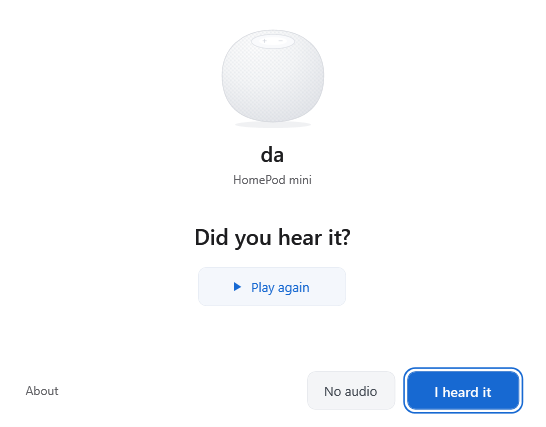

<p align="center">
  
</p>

<h1 align="center">AppleHomePod for Windows</h1>

<p align="center">Play your Windows audio through HomePod.</p>

<p align="center"><strong>English</strong> · <a href="README.zh-CN.md">简体中文</a></p>

<p align="center">
  <a href="https://github.com/shenmuegit/AppleHomePod-windows/releases/download/v0.2.0-preview.3/AppleHome-0.2.0-9cf79335d419.zip"><strong>Download Windows preview</strong></a>
  &nbsp;·&nbsp; <a href="#get-started">Get started</a>
  &nbsp;·&nbsp; <a href="#compatibility">Compatibility</a>
  &nbsp;·&nbsp; <a href="https://github.com/shenmuegit/AppleHomePod-windows/releases/tag/v0.2.0-preview.3">Release notes</a>
</p>

<p align="center">
  <a href="https://github.com/shenmuegit/AppleHomePod-windows/releases/tag/v0.2.0-preview.3"></a>
  <a href="LICENSE-GPLv3"></a>
</p>

AppleHomePod sends music, video and system audio from your PC to HomePod over your local network. After setup, use the Windows output menu and volume controls with the players you already have.

> **Preview:** tested on Windows 10 Pro 22H2 (build 19045, x64) with one HomePod mini running software 27.0. Other Windows versions, HomePod models and stereo pairs have not been validated.

<p align="center">
  
</p>

<p align="center"><sub>Setup follows your Windows display language. Shown in English.</sub></p>

## Use Windows controls

The setup wizard discovers HomePod, configures the output device and handles connection timing for you. Once connected, adjust volume or mute from Windows. Switch to your headphones or speakers in the same output menu when you need them.

The background app starts when you sign in. Everyday playback does not require a separate mixer, control panel or tray menu. You do not need to enter an IP address, select a network adapter or choose a buffer size.

## Get started

1. Set up HomePod in Apple's Home app and connect it to the same local network as your PC. The PC can use Wi-Fi or Ethernet.
2. [Download the preview ZIP](https://github.com/shenmuegit/AppleHomePod-windows/releases/download/v0.2.0-preview.3/AppleHome-0.2.0-9cf79335d419.zip), extract it and open **`AppleHome.exe`**. The app is self-contained; you do not need to install .NET or Rust.
3. Follow the setup wizard. Allow the audio driver installation when Windows asks. If a restart is required, save your work, restart Windows and open the app again.
4. Wait for HomePod to connect, then confirm that you hear the setup audio. Use the replay button if you need to hear it again.

Setup follows the Windows preferred display language: English, Simplified Chinese or Traditional Chinese, with English as the fallback. With one eligible HomePod, connection is automatic; with several, choose a device. The wizard names the Windows output and selects it for you.

A full first-install test, including driver setup and the required restart, is still pending. Playback in this release was verified with an existing qualified driver and device record.

**Updating an earlier preview?** Reopening the wizard reuses the installed app. Follow the [English update instructions](docs/installation.md#update-an-existing-preview) to replace its background process while retaining the qualified device record. Automatic updates are not available.

## In Preview 3

If HomePod discovery information disappeared briefly, the previous background app could exit and leave later playback silent. Preview 3 removes that fatal two-second cutoff and restores qualified connections automatically.

- Failed discovery queries restart with backoff. Queries that never resolve and expired records are refreshed.
- Transient audio failures can recover after a retry batch is exhausted. Authentication and device qualification checks remain enforced.
- Setup now selects English, Simplified Chinese or Traditional Chinese from Windows automatically.

The update preserves device calibration, timing records, Windows volume controls and the existing setup interface. See the [release notes](docs/releases/v0.2.0-preview.3.md) for the validation scope.

## Compatibility

| Environment | Preview status |
|---|---|
| Windows 10 Pro 22H2, build 19045, x64 + one HomePod mini on software 27.0 | Normal-music recovery checked; build-specific scope below |
| Other Windows 10 builds; Windows 11 x64 | Not yet validated |
| HomePod (1st or 2nd generation); other mini firmware | Not yet validated; the current wizard does not enable these device profiles |
| Stereo pairs and Apple TV groups | Not yet validated; not enabled by the current wizard |

During this repair, normal music resumed after a listener-reported pause of at least one minute and remained continuous. The final build was checked for background readiness, preserved Windows output and volume, and live music transport with zero observed send or synchronization errors. Discovery and retry failures were tested with simulated faults; the physical network was not interrupted.

**Overnight idle followed by playback has not been tested on hardware.** A new manual volume/mute cycle, a 30-minute run and sustained video synchronization were not repeated for this binary. Earlier builds passed those separately documented checks on the same device; they do not qualify this build automatically.

This preview does not promise measured end-to-end latency. Windows 11, network-outage recovery and other Home access or PIN policies still need hardware testing. The executable is unsigned and automatic updates are not available. See the [detailed compatibility record](docs/COMPATIBILITY.md) (Chinese).

## Downloads and integrity

| File | Purpose |
|---|---|
| [Windows preview](https://github.com/shenmuegit/AppleHomePod-windows/releases/download/v0.2.0-preview.3/AppleHome-0.2.0-9cf79335d419.zip) | App, original driver package, licenses and build records |
| [Matching source archive](https://github.com/shenmuegit/AppleHomePod-windows/releases/download/v0.2.0-preview.3/AppleHome-source-9cf79335d419.zip) | Source and dependency locks for the published binary |
| [English installation guide](https://github.com/shenmuegit/AppleHomePod-windows/releases/download/v0.2.0-preview.3/INSTALL.md) | Current setup and update instructions |
| [SHA256SUMS.txt](https://github.com/shenmuegit/AppleHomePod-windows/releases/download/v0.2.0-preview.3/SHA256SUMS.txt) | Checksums for the release attachments |

Check the download in PowerShell and compare the result with `SHA256SUMS.txt`:

```powershell
Get-FileHash .\AppleHome-0.2.0-9cf79335d419.zip -Algorithm SHA256
```

The release tag `v0.2.0-preview.3` points to binary source commit [`9cf7933`](https://github.com/shenmuegit/AppleHomePod-windows/commit/9cf79335d419a45912156c0261435c9621487796). The installed repair executable and matching archives are preserved without rebuilding. Archived documentation is a build-time snapshot; the attached installation guides and release notes describe this release.

## Build and contribute

The app uses WPF/.NET for Windows integration, WASAPI for system-audio capture and a Rust engine for audio transport. Internal assembly names remain `AirFlash`; the distributed app is `AppleHome.exe`.

<details>
<summary>Build from source</summary>

Build on Windows x64 with the .NET SDK specified in `desktop/global.json`, a Rust MSVC toolchain, Visual Studio C++ Build Tools, Python 3.12+, uv and PowerShell 7.

```powershell
git clone https://github.com/shenmuegit/AppleHomePod-windows.git
cd AppleHomePod-windows
uv sync --locked --group dev
pwsh -NoProfile -File scripts/build-native.ps1 -Check
pwsh -NoProfile -File scripts/dotnet.ps1 restore AirFlash.sln --locked-mode
pwsh -NoProfile -File scripts/dotnet.ps1 test AirFlash.sln --no-restore
uv run pytest -q
uv run ruff check .
```

Architecture, packaging and validation notes are currently in Chinese:
[architecture](docs/architecture.md) · [packaging](docs/packaging.md) · [validation](docs/VALIDATION.md).

</details>

For a bug report, include your Windows build, HomePod model and software version, whether it is a single speaker or a pair, and the steps that reproduce the issue. Remove pairing data and device identifiers before sharing logs. Use [GitHub Issues](https://github.com/shenmuegit/AppleHomePod-windows/issues) for reports and proposals.

## License and credits

Based on [AirFlash](https://github.com/Ding-Kyoma/AirFlash) by Ding-Kyoma and its contributors. This project's changes are licensed under **GPLv3 or later**. Upstream copyright and third-party notices are retained. See [source provenance](UPSTREAM.md), the [GPL text](LICENSE-GPLv3) and [third-party notices](desktop/THIRD-PARTY-NOTICES.md). The upstream commercial license does not cover this project's changes.

The bundled **VB-CABLE** driver is separate software by [VB-Audio Software](https://vb-cable.com/), distributed under its own [Donationware terms](https://vb-audio.com/Services/licensing.htm). Donations or license payments to its author are welcome. The original Pack45 package and vendor readme are preserved, and the app's About view links to the driver source and terms. VB-CABLE is not covered by this project's GPL license.
