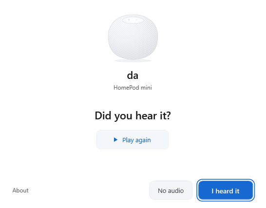

<p align="center">
  
</p>

<h1 align="center">AppleHomePod for Windows</h1>

<p align="center">Play your Windows audio through HomePod.</p>

<p align="center"><strong>English</strong> · <a href="README.zh-CN.md">简体中文</a></p>

<p align="center">
  <a href="https://github.com/shenmuegit/AppleHomePod-windows/releases/download/v0.2.0-preview.5/AppleHome-0.2.0-6fc6482b1521.zip"><strong>Download Windows preview</strong></a>
  &nbsp;·&nbsp; <a href="#get-started">Get started</a>
  &nbsp;·&nbsp; <a href="#compatibility">Compatibility</a>
  &nbsp;·&nbsp; <a href="https://github.com/shenmuegit/AppleHomePod-windows/releases/tag/v0.2.0-preview.5">Release notes</a>
</p>

<p align="center">
  <a href="https://github.com/shenmuegit/AppleHomePod-windows/releases/tag/v0.2.0-preview.5"></a>
  <a href="LICENSE-GPLv3"></a>
</p>

AppleHomePod sends music, video and system audio from your PC to HomePod over your local network. After setup, use the Windows output menu and volume controls with the players you already have.

> **Preview 5:** verified on Windows 10 Pro 22H2 (build 19045, x64) with one standalone HomePod mini running software 27.2. Other combinations can attempt playback, but have not been validated on hardware.

<p align="center">
  
</p>

<p align="center"><sub>Setup follows your Windows display language. Shown in English.</sub></p>

## Use Windows controls

The setup wizard discovers HomePod, configures the output device and handles connection timing for you. Once connected, adjust volume or mute from Windows. Switch to your headphones or speakers in the same output menu when you need them.

The background app starts when you sign in. Everyday playback does not require a separate mixer, control panel or tray menu. You do not need to enter an IP address, select a network adapter or choose a buffer size.

## Get started

1. Set up HomePod in Apple's Home app and connect it to the same local network as your PC. The PC can use Wi-Fi or Ethernet.
2. [Download the preview ZIP](https://github.com/shenmuegit/AppleHomePod-windows/releases/download/v0.2.0-preview.5/AppleHome-0.2.0-6fc6482b1521.zip), extract it and open **`AppleHome.exe`**. The app is self-contained; you do not need to install .NET or Rust.
3. Follow the setup wizard. Allow the audio driver installation when Windows asks. If a restart is required, save your work, restart Windows and open the app again.
4. Wait for HomePod to connect, then confirm that you hear the setup audio. Use the replay button if you need to hear it again.

Setup follows the Windows preferred display language: English, Simplified Chinese or Traditional Chinese, with English as the fallback. With one discovered HomePod that has valid connection details, connection is automatic; with several, choose a device. The wizard names the Windows output and selects it for you.

A full first-install test, including driver setup and the required restart, is still pending for this build. Playback was verified by updating an existing installation with a valid driver, device binding and calibration.

**Updating an earlier preview?** Reopening the wizard reuses the installed app. Follow the [English update instructions](docs/installation.md#update-an-existing-preview) to replace its background process while retaining the device binding and calibration. Automatic updates are not available.

## In Preview 5

A HomePod firmware update could leave a discoverable, previously working speaker silent: the app treated a timing preference for one model and firmware as permission to play. Preview 5 removes that model and firmware allowlist from background playback, setup, reference preparation and the device picker. Connection attempts now depend on valid device identity and connection details, followed by the actual protocol handshake and authentication.

- Timing and codec preferences guide the transport without blocking other models or firmware. Buffer selection stays automatic, with records scoped to the device profile.
- While Windows selects the HomePod output, the background keeps trying to recover a failed engine. Switching away releases it; silence, pause, mute and accumulated failures do not end the playback intent.
- Automatic mDNS failover and the English, Simplified Chinese and Traditional Chinese setup interface remain available.

See the [release notes](docs/releases/v0.2.0-preview.5.md) and the fix in [PR #2](https://github.com/shenmuegit/AppleHomePod-windows/pull/2).

## Compatibility

| Environment | Preview status |
|---|---|
| Windows 10 Pro 22H2, build 19045, x64 + one standalone HomePod mini on software 27.2 | Preview 5: continuous normal music, Windows volume changes and recovery after at least 15 seconds of mute confirmed |
| The same PC and mini on software 27.0 | Earlier-build results only; not a Preview 5 rerun |
| Other Windows 10 builds; Windows 11 x64 | Not yet validated |
| HomePod (1st or 2nd generation); other mini firmware | No model or firmware allowlist; hardware compatibility not yet validated |
| Stereo pairs and Apple TV groups | Not yet validated; discovery, identity, topology and protocol requirements still apply |

Playback eligibility and verified compatibility are separate: removing the allowlist lets devices attempt a connection; it does not prove every HomePod or access policy works. The November 15 acceptance used the mini on software 27.2. Its negotiated 250 ms buffer candidate is specific to that session, not a universal default or a measurement of acoustic latency. A firmware change does not turn an older profile's saved timing into a verified reference for the new profile.

**Overnight idle followed by playback and real sleep/wake recovery have not been tested on hardware for this release.** Earlier 30-minute music and five-minute video observations remain attributed to their original builds. Output reselection has recovered in an earlier supervision candidate, but the first attempt was delayed; seamless switching is not a validated guarantee.

This preview does not promise measured end-to-end latency. Network-outage recovery and other Home access or PIN policies still need hardware testing. The executable is unsigned and automatic updates are not available. See the [detailed compatibility record](docs/COMPATIBILITY.md) (Chinese).

## Downloads and integrity

| File | Purpose |
|---|---|
| [Windows preview](https://github.com/shenmuegit/AppleHomePod-windows/releases/download/v0.2.0-preview.5/AppleHome-0.2.0-6fc6482b1521.zip) | App, original driver package, licenses and build records |
| [Matching source archive](https://github.com/shenmuegit/AppleHomePod-windows/releases/download/v0.2.0-preview.5/AppleHome-source-6fc6482b1521.zip) | Source and dependency locks for the published binary |
| [English installation guide](https://github.com/shenmuegit/AppleHomePod-windows/releases/download/v0.2.0-preview.5/INSTALL.md) | Current setup and update instructions |
| [SHA256SUMS.txt](https://github.com/shenmuegit/AppleHomePod-windows/releases/download/v0.2.0-preview.5/SHA256SUMS.txt) | Checksums for the release attachments |

Check the download in PowerShell and compare the result with `SHA256SUMS.txt`:

```powershell
Get-FileHash .\AppleHome-0.2.0-6fc6482b1521.zip -Algorithm SHA256
```

The release tag `v0.2.0-preview.5` points to binary source commit [`6fc6482`](https://github.com/shenmuegit/AppleHomePod-windows/commit/6fc6482b152188f29e37a9a7d55f8502ebec29ad). The installed repair executable and matching archives are preserved without rebuilding. Archived documentation is a build-time snapshot; the attached installation guides and release notes describe this release.

## Build and contribute

The app uses WPF/.NET for Windows integration, WASAPI for system-audio capture and a Rust engine for audio transport. Internal assembly names remain `AirFlash`; the distributed app is `AppleHome.exe`.

<details>
<summary>Build from source</summary>

Build on Windows x64 with the .NET SDK specified in `desktop/global.json`, a Rust MSVC toolchain, Visual Studio C++ Build Tools, Python 3.12+, uv and PowerShell 7.

```powershell
git clone https://github.com/shenmuegit/AppleHomePod-windows.git
cd AppleHomePod-windows
uv sync --locked --group dev
pwsh -NoProfile -File scripts/build-native.ps1 -Check
pwsh -NoProfile -File scripts/dotnet.ps1 restore AirFlash.sln --locked-mode
pwsh -NoProfile -File scripts/dotnet.ps1 test AirFlash.sln --no-restore
uv run pytest -q
uv run ruff check .
```

Architecture, packaging and validation notes are currently in Chinese:
[architecture](docs/architecture.md) · [packaging](docs/packaging.md) · [validation](docs/VALIDATION.md).

</details>

For a bug report, include your Windows build, HomePod model and software version, whether it is a single speaker or a pair, and the steps that reproduce the issue. Remove pairing data and device identifiers before sharing logs. Use [GitHub Issues](https://github.com/shenmuegit/AppleHomePod-windows/issues) for reports and proposals.

## License and credits

Based on [AirFlash](https://github.com/Ding-Kyoma/AirFlash) by Ding-Kyoma and its contributors. This project's changes are licensed under **GPLv3 or later**. Upstream copyright and third-party notices are retained. See [source provenance](UPSTREAM.md), the [GPL text](LICENSE-GPLv3) and [third-party notices](desktop/THIRD-PARTY-NOTICES.md). The upstream commercial license does not cover this project's changes.

The bundled **VB-CABLE** driver is separate software by [VB-Audio Software](https://vb-cable.com/), distributed under its own [Donationware terms](https://vb-audio.com/Services/licensing.htm). Donations or license payments to its author are welcome. The original Pack45 package and vendor readme are preserved, and the app's About view links to the driver source and terms. VB-CABLE is not covered by this project's GPL license.
