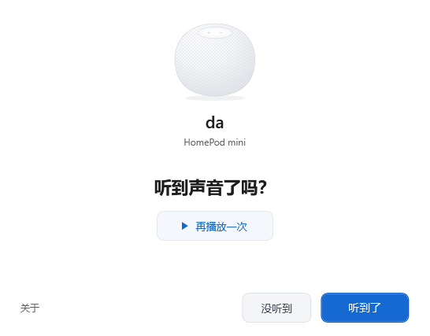

<p align="center">
  
</p>

<h1 align="center">AppleHomePod for Windows</h1>

<p align="center">让 Windows 的声音在 HomePod 上播放。</p>

<p align="center"><a href="README.md">English</a> · <strong>简体中文</strong></p>

<p align="center">
  <a href="https://github.com/shenmuegit/AppleHomePod-windows/releases/download/v0.2.0-preview.3/AppleHome-0.2.0-9cf79335d419.zip"><strong>下载 Windows 预览版</strong></a>
  &nbsp;·&nbsp; <a href="#开始使用">开始使用</a>
  &nbsp;·&nbsp; <a href="#兼容范围">兼容范围</a>
  &nbsp;·&nbsp; <a href="https://github.com/shenmuegit/AppleHomePod-windows/releases/tag/v0.2.0-preview.3">版本说明</a>
</p>

<p align="center">
  <a href="https://github.com/shenmuegit/AppleHomePod-windows/releases/tag/v0.2.0-preview.3"></a>
  <a href="LICENSE-GPLv3"></a>
</p>

AppleHomePod 通过局域网，把电脑上的音乐、视频和系统声音发送到 HomePod。完成设置后，继续使用原来的播放器，通过 Windows 输出选择、音量和静音控件操作。

> **预览版：**已验证 Windows 10 Pro 22H2（19045，x64）与单只 HomePod mini 27.0。其他 Windows 版本、HomePod 型号和立体声对尚未实机验证。

<p align="center">
  
</p>

<p align="center"><sub>向导随 Windows 显示语言自动切换。图中为简体中文。</sub></p>

## 使用 Windows 原生控件

安装向导会自动发现 HomePod、配置输出设备并处理连接参数。连接后，用 Windows 调整音量和静音；需要使用耳机或电脑扬声器时，在同一个输出菜单中切换即可。

后台随用户登录启动，日常无需额外打开混音器、控制面板或托盘菜单。无需填写 IP、选择网卡或输入缓冲毫秒数。

## 开始使用

1. 先在 Apple「家庭」App 中设置 HomePod，并让它与电脑连接同一局域网。电脑可以使用 Wi-Fi 或有线网络。
2. [下载预览版 ZIP](https://github.com/shenmuegit/AppleHomePod-windows/releases/download/v0.2.0-preview.3/AppleHome-0.2.0-9cf79335d419.zip)，解压并打开 **`AppleHome.exe`**。应用为自包含版本，无需另装 .NET 或 Rust。
3. 按向导完成音频驱动安装。Windows 要求管理员许可时按提示操作；若需要重启，先保存工作，重启后重新打开应用。
4. 等待 HomePod 连接，然后确认是否听到声音。需要重听时，点击「再播放一次」。

只有一只合格 HomePod 时会自动连接；有多只时选择目标设备。Windows 输出名称、首次播放输出和连接参数由向导配置。听到声音后点击「听到了」完成设置；没有出声时点击「没听到」检查并重试。

本发布包的完整首次安装流程，包括全新自动驱动安装与必要重启，仍待实机验证。当前播放验收使用已有合格驱动和设备记录。

**更新已有预览版：**重新打开向导会复用已安装程序。请按[中文更新说明](docs/first-run.md#已有预览安装)替换后台，保留已有合格设备记录。目前没有自动更新功能。

## Preview 3 的改进

旧版在 HomePod 发现信息短暂缺失时，可能退出整个后台，导致稍后播放无声。Preview 3 移除了这条致命的 2 秒截止条件，并在合格设备信息恢复后自动连接。

- 发现查询失败后按退避间隔重启；长期没有解析结果的查询和过期记录会重新查询。
- 可重试音频故障在一轮重试用尽后仍能继续恢复，身份、认证和设备资格校验保持有效。
- 安装向导按 Windows 首选显示语言自动选择英文、简体中文或繁体中文，其他语言回退英文。

本次更新保留设备校准、缓冲记录、Windows 音量逻辑和现有安装界面。验证范围见[版本说明](docs/releases/v0.2.0-preview.3.md)（英文）。

## 兼容范围

| 环境 | 预览版状态 |
|---|---|
| Windows 10 Pro 22H2，19045，x64 + 单只 HomePod mini 27.0 | 已检查正常音乐恢复；具体构建的范围见下文 |
| Windows 10 其他构建；Windows 11 x64 | 尚未实机验证 |
| HomePod 第 1、2 代；mini 其他固件 | 尚未验证，当前向导未放行这些设备档案 |
| 立体声对、Apple TV 分组 | 尚未验证，当前向导未放行 |

本轮修复期间，旁听者确认正常音乐暂停至少 1 分钟后自行恢复，声音连续。最终构建检查了后台就绪、Windows 输出和音量保留，以及正常音乐传输，观察中的发送和同步错误为 0。发现与重试故障采用模拟注入验证，没有中断实际网络。

**过夜空闲后再次播放尚未实机验证。** 本构建没有重新执行手动音量／静音循环、30 分钟持续播放和持续视频同步检查。同一设备早期构建的相关结果分别保留，不自动算作本版通过。

当前不承诺已测量的端到端延迟。Windows 11、断网恢复、其他家庭访问或 PIN 策略仍待实测。EXE 尚未签名，未提供自动更新。逐版本证据见[详细兼容记录](docs/COMPATIBILITY.md)。

## 下载与完整性校验

| 文件 | 用途 |
|---|---|
| [Windows 预览版](https://github.com/shenmuegit/AppleHomePod-windows/releases/download/v0.2.0-preview.3/AppleHome-0.2.0-9cf79335d419.zip) | 应用、原始驱动包、许可和构建记录 |
| [对应源码包](https://github.com/shenmuegit/AppleHomePod-windows/releases/download/v0.2.0-preview.3/AppleHome-source-9cf79335d419.zip) | 与发布二进制对应的源码和依赖锁文件 |
| [中文安装指南](https://github.com/shenmuegit/AppleHomePod-windows/releases/download/v0.2.0-preview.3/INSTALL.zh-CN.md) | 安装与已有预览版的更新方式 |
| [SHA256SUMS.txt](https://github.com/shenmuegit/AppleHomePod-windows/releases/download/v0.2.0-preview.3/SHA256SUMS.txt) | 发布附件的校验值 |

在 PowerShell 中计算下载文件的 SHA256，与同一 Release 的 `SHA256SUMS.txt` 对照：

```powershell
Get-FileHash .\AppleHome-0.2.0-9cf79335d419.zip -Algorithm SHA256
```

发布标签 `v0.2.0-preview.3` 对应二进制源码提交 [`9cf7933`](https://github.com/shenmuegit/AppleHomePod-windows/commit/9cf79335d419a45912156c0261435c9621487796)。已安装修复版的 EXE 与对应归档保持原样，没有重新编译。归档中的文档保留构建时快照；当前安装步骤和验证范围以 Release 随附的指南和版本说明为准。

## 构建与参与

应用使用 WPF/.NET 集成 Windows，使用 WASAPI 采集系统声音，由 Rust 引擎负责音频传输。内部程序集仍使用 `AirFlash` 名称，分发程序为 `AppleHome.exe`。

<details>
<summary>从源码构建</summary>

需要 Windows x64、`desktop/global.json` 指定的 .NET SDK、Rust MSVC 工具链、Visual Studio C++ Build Tools、Python 3.12+、uv 和 PowerShell 7。

```powershell
git clone https://github.com/shenmuegit/AppleHomePod-windows.git
cd AppleHomePod-windows
uv sync --locked --group dev
pwsh -NoProfile -File scripts/build-native.ps1 -Check
pwsh -NoProfile -File scripts/dotnet.ps1 restore AirFlash.sln --locked-mode
pwsh -NoProfile -File scripts/dotnet.ps1 test AirFlash.sln --no-restore
uv run pytest -q
uv run ruff check .
```

开发文档：[架构](docs/architecture.md) · [打包](docs/packaging.md) · [验证](docs/VALIDATION.md)。

</details>

反馈问题时，请提供 Windows 构建号、HomePod 型号与软件版本、单只或立体声对，以及复现步骤。分享日志前移除配对数据和设备标识。问题与建议请提交到 [GitHub Issues](https://github.com/shenmuegit/AppleHomePod-windows/issues)。

## 许可与致谢

基于 Ding-Kyoma 及其贡献者的 [AirFlash](https://github.com/Ding-Kyoma/AirFlash)。本项目改动采用 **GPLv3 或更新版本**，保留上游版权和第三方声明。详见[源码来源](UPSTREAM.md)、[GPL 全文](LICENSE-GPLv3)及[第三方声明](desktop/THIRD-PARTY-NOTICES.md)。上游商业许可不覆盖本项目改动。

随附的 **VB-CABLE** 是 [VB-Audio Software](https://vb-cable.com/) 的独立软件，遵循其 [Donationware 条款](https://vb-audio.com/Services/licensing.htm)。欢迎向作者捐助或支付许可。原厂 Pack45 和厂商说明保持未修改，应用「关于」页提供来源与条款入口。VB-CABLE 不属于本项目的 GPL 许可范围。
