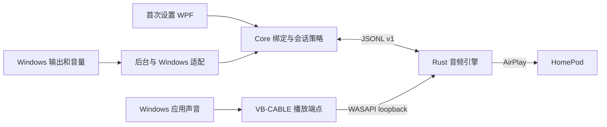

# AppleHome 当前架构与目录约定

AppleHome 是 Windows 原生输出应用。首次设置使用 WPF 向导，日常使用 Windows 输出选择、主音量、静音和应用混音器；.NET 主机负责策略和 Windows 集成，Rust 子进程负责音频与 AirPlay。当前支持范围以 [COMPATIBILITY.md](COMPATIBILITY.md) 为准，使用步骤见 [first-run.md](first-run.md)。

## 入口与职责

| 入口 | 职责 |
|---|---|
| 无参数启动 | 首次设置或当前连接状态；已有合格设置不重复安装 |
| `--native-agent` | 登录时启动的无窗口后台；监听 Windows 输出及音量并管理发送会话 |
| `--native-check` 等检查命令 | 只读诊断与验证，不以检查通过代替设备可听确认 |
| `--native-enable`、`--native-disable` 等维护命令 | 管理本应用拥有的后台安装、任务和绑定，执行身份及所有权检查 |
| `--legacy-panel` | 保留的上游面板诊断路径，不是日常原生输出入口 |

Program 在初始化 WPF 前分派后台和维护入口。App 负责装配具体 Windows 服务并引用 Core；Core 不引用 App。测试引用生产 App 与 Core 程序集，不在测试项目里重新编译 App 源文件。

## 控制状态与音频路径

NativeOutputAgent 常驻监听 Windows 输出。NativeEngineSupervisor 仅在普通播放角色（console 或 multimedia）选择已绑定端点时创建引擎；切出时取消并等待该轮资源释放，切回后创建新引擎。单独的通讯角色或应用音频会话不能维持发送引擎。

只要 Windows 仍选择该输出，空闲、暂停、静音、累计运行时间或故障次数都不会结束运行意图。失效引擎必须先退役，再按有间隔、无次数上限的规则重新创建；不添加睡眠或唤醒事件驱动的释放策略。设备身份、校准、协议与音量门校验仍然保留，不合格数据不会因重试而放行。

NativeOutputController 处理当前引擎的路由和 Windows 音量。SessionController 与 NativeEngineHost 管理连接和采集；原生路径由控制器负责会话重试，避免叠加历史面板的次数限制。进程通信仍对单次操作、读入大小和事件队列设置健康边界；操作失败触发恢复，不能永久停用仍被选中的输出。常驻监听就绪与实际采集、传输就绪分别报告。

向导与已安装后台使用当前 Windows 用户限定的命名管道。原有激活、停止和采集就绪命令保留兼容；传输状态查询提供目标、路由代际、发现、连接、音量门及实际首包状态。准备确认音频时等待当前路由的真实状态，不用固定两秒推测连接已经完成。传输就绪只能证明发送链路达到相应状态，仍须用户明确确认实际听感。

Windows 声音通过绑定的虚拟播放端点进入 Rust 的 WASAPI loopback。该路径不依赖先播放到物理扬声器后再静音；录音和麦克风端点不在系统音频采集范围。Windows 音量、端点身份核验、音量校准和按设备延迟记录属于不同职责，不能互相代替。

## 生产代码与验证代码

- `desktop/AirFlash.App/Ui`、`ViewModels`：当前窗口与保留面板。
- `desktop/AirFlash.App/Services`：Windows 适配、后台装配与维护服务。
- `desktop/AirFlash.App/Services/Setup`：生产所需的校准、确认音频及其生命周期。
- `desktop/AirFlash.App/Verification`：只读检查、模拟 UI、性能和诊断入口；通过生产服务完成验证，不拥有正常安装的业务实现。
- `desktop/AirFlash.Core`：绑定与资格策略、会话、状态契约、进程通信、配置与恢复规则。
- `desktop/AirFlash.Tests`：面向实际生产类型的 Windows .NET 测试；软件测试与需硬件的验收明确区分。
- `native/airflash-engine/src` 与 `tests`：Rust 音频实现与协议/连续性回归。
- 根 `tests`：PowerShell 工具链、打包、诊断和分析工具的 Python 回归。

内部程序集和命名空间保留 AirFlash 名称，用户产品名称为 AppleHome。目录整理不要求修改已有协议身份、配置格式或安装任务名称。

## 数据归属与交付

| 数据 | 归属 |
|---|---|
| `config.json` | 历史面板偏好；不等同于当前原生输出的设备绑定 |
| `native-output.json` | 已验证播放端点、校准及按设备/固件档案关联的缓冲参考 |
| `native-startup.json` | 本应用后台任务及安装 EXE 的所有权凭据 |
| 设置输出事务日志 | 设置失败或取消时恢复仍由本应用拥有的名称、默认输出和音量改动 |
| 程序日志与按哈希解包的引擎 | 应用自身的 Windows 用户数据和缓存 |

正式安装使用 Windows 用户目录；开发产生的工具、临时文件、缓存、报告与交付物留在所属项目内。源码不包含用户绑定、配对凭据或本机验收日志。

`scripts` 中的受版本管理入口负责构建、验证和打包。`artifacts` 保存工具、缓存、每轮 staging 和验证报告；`dist` 保存版本/提交区分的不可变交付目录。失败的构建或重复打包不得删除、替换旧交付物。`.worktrees` 保存项目内隔离工作树，其忽略规则随仓库分发；历史工作树及其报告不由构建命令清理。

打包必须将 EXE、对应源码提交、原始第三方输入和明确的验证记录关联，生成源码 ZIP、manifest 与 SHA256SUMS。软件回归通过不自动生成 HomePod 听感、Windows11 或其他设备的资格结论。

## 当前与历史说明

[项目首页](../README.md)、首次设置和兼容矩阵是当前入口。[验收记录](validation/windows-native-homepod-output.md)保留各轮真实条件与限制；[UPSTREAM.md](../UPSTREAM.md)保留来源、许可和导入时的历史证据。旧中文 AirFlash 指南已明确标记为上游历史说明，不能用它推广 AppleHome 的设备或采集支持范围。
